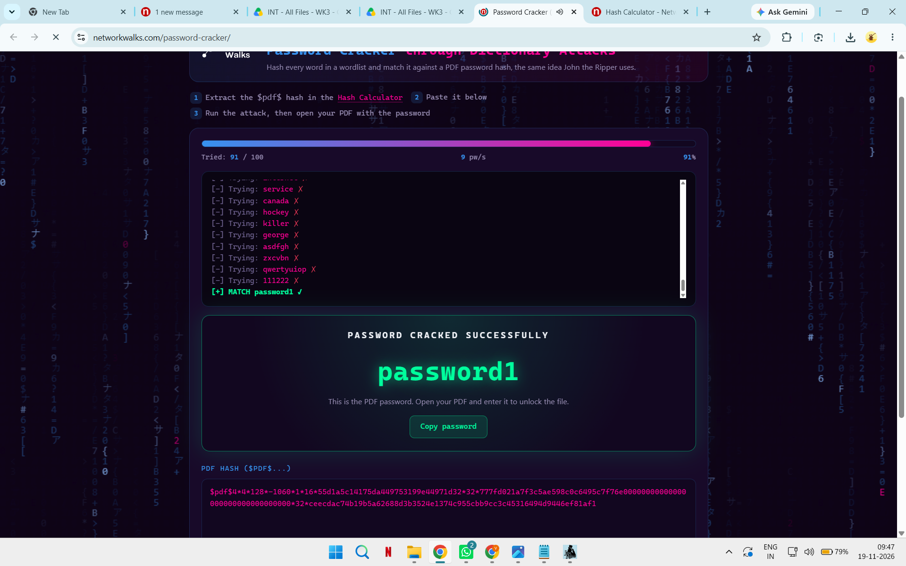
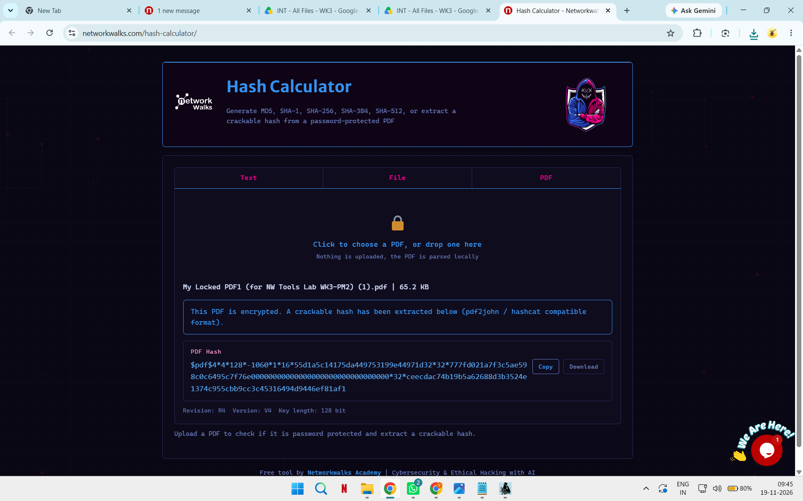
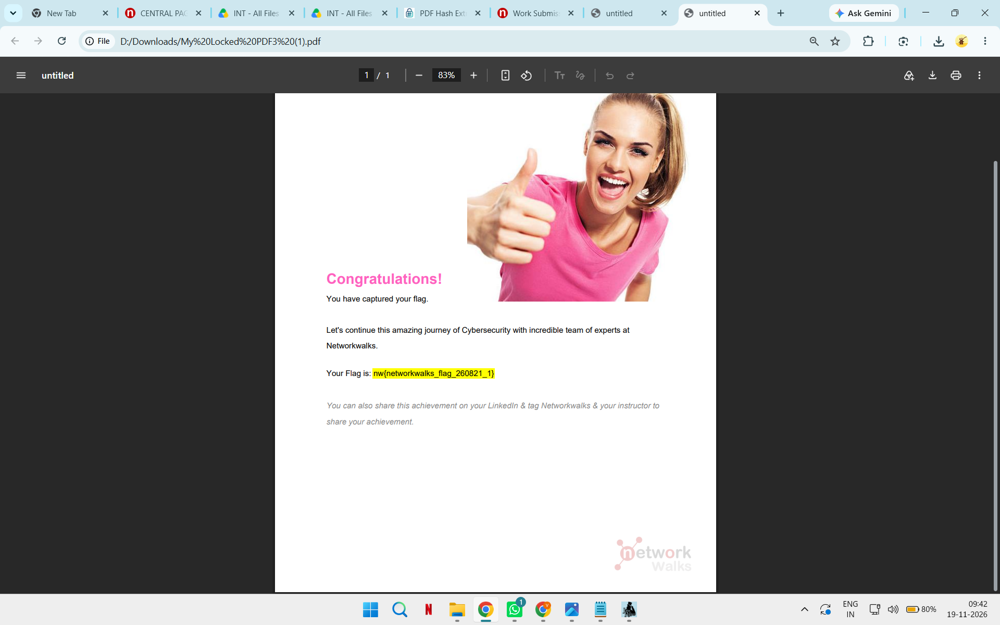
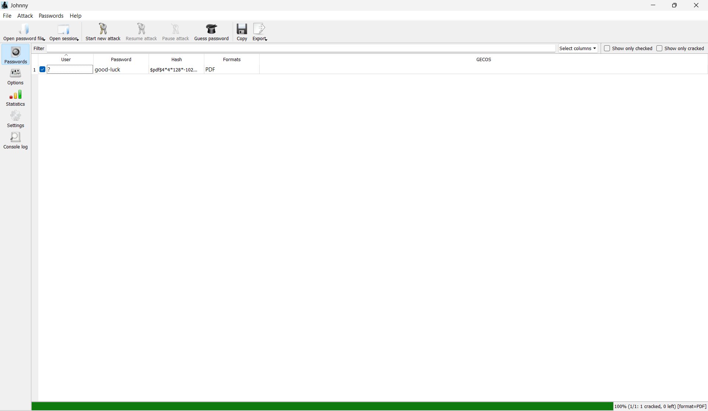
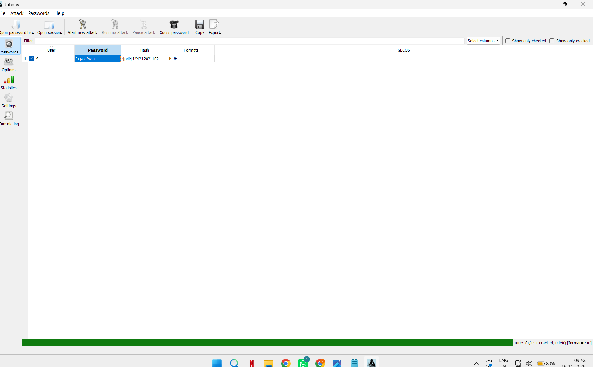

# Week 3 Lab: Hash Extraction & Password Cracking (Johnny GUI)

This repository contains screenshot documentation and execution results from a cybersecurity lab focused on cryptographic hash extraction, PDF password protection analysis, and offline password auditing using **Johnny** (the graphical frontend for **John the Ripper**) and related utilities.

---

## 🛠️ Tools & Concepts Covered

* **Tools:** Johnny (John the Ripper GUI), John the Ripper backend, `pdf2john`.
* **Techniques:**
  * Loading password hashes into the Johnny graphical interface.
  * Configuring dictionary, rule-based, and brute-force attack modes via GUI options.
  * Extracting password hashes from encrypted PDF documents.
  * Monitoring real-time cracking progress, guessing rates, and recovered credentials in Johnny.

---

## 📸 Lab Execution & Screenshots

### 1. Password Cracker Interface & Hash Loading

#### Johnny GUI / Password Cracker Overview (`Week-3/passcracker.png`)
Main graphical interface showing loaded hash entries and attack configuration options.

#### Hash & Attack Parameter Setup (`Week-3/calulator.png`)
Additional hash/parameter calculation and configuration view.

#### Password Manager / Target Entry (`Week-3/pm2.png`)
Target credential management and hash entry verification.

---

### 2. PDF Protection & Hash Extraction (`pdf2john`)

#### Extracting PDF Hash (`Week-3/pdf1.png`)
Extracting the password hash from a password-protected PDF file.

#### Verifying Extracted Hash Structure (`Week-3/pdf2.png`)
Inspecting the extracted PDF hash format and importing it for auditing.

#### PDF Encryption Metadata (`Week-3/pdf3.png`)
Additional PDF encryption metadata and security parameters.

---

### 3. Cracking Passwords with Johnny (John the Ripper GUI)

#### Configuring & Starting the Attack (`Week-3/johnriper1.png`)
Selecting the attack mode (wordlist/rules) and initiating the cracking session in Johnny.

#### Monitoring Cracking Progress (`Week-3/johnriper2.png`)
Monitoring live session status, progress percentage, and candidate testing in the GUI.

#### Recovered Passwords Output (`Week-3/johnriper3.png`)
Viewing the cracked plaintext passwords displayed directly in Johnny's results table.

---

## ⚠️ Disclaimer

> **For Educational Purposes Only:** The techniques and tools documented in this repository were executed in a controlled lab environment for educational and defensive security auditing purposes. Always obtain explicit authorization before testing or auditing systems and files you do not own.